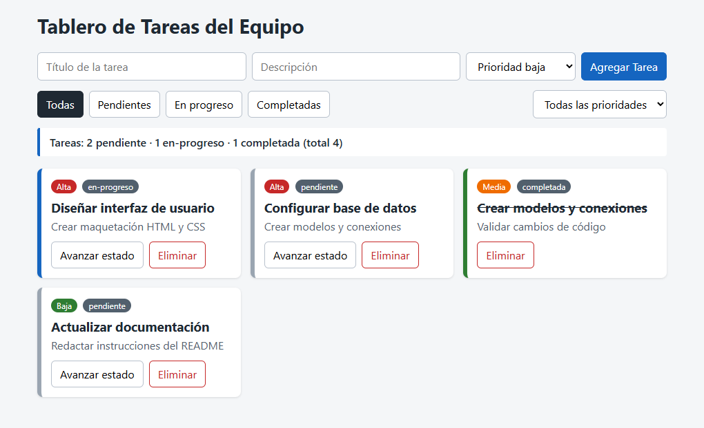
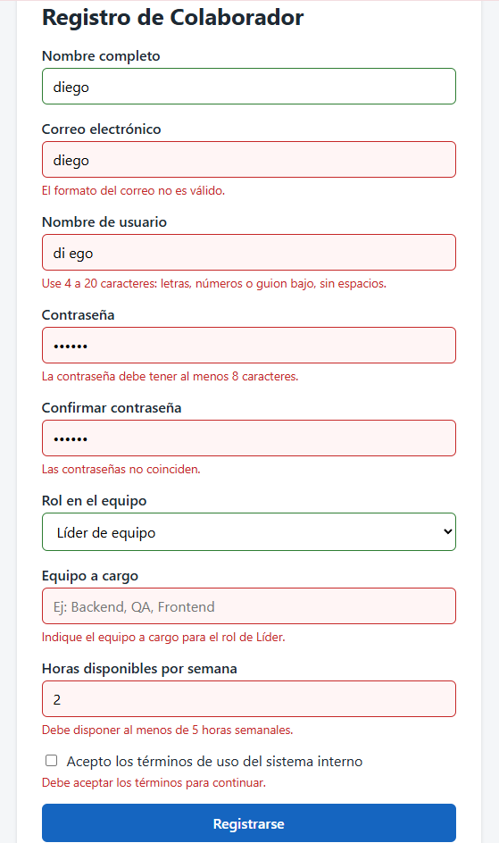
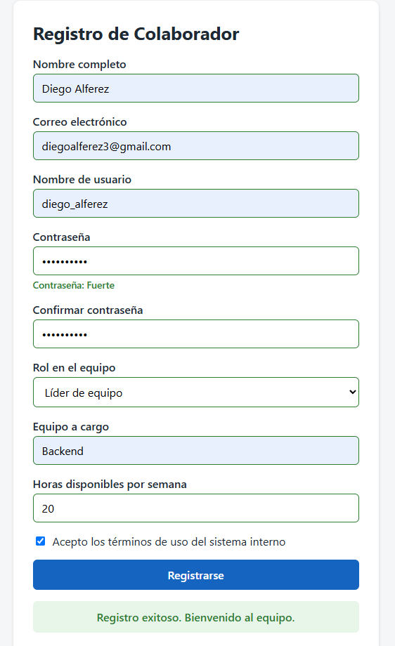

# Post-contenido — Unidad 4: JavaScript Básico

**Estudiante:** Diego Alferez

**Curso:** Programación Web — Universidad Francisco de Paula Santander (UFPS)

## Descripción

Repositorio del laboratorio de la Unidad 4 de Programación Web — Séptimo Semestre. Contiene dos partes que forman un mismo sistema interno de equipo: un tablero de tareas con manipulación del DOM y eventos (`parte-1-tablero-tareas/`) y un formulario de registro de colaborador con validación manual y Constraint Validation API (`parte-2-formulario-colaborador/`).

**Tecnologías:** HTML5, CSS3 y JavaScript puro (ES6+), sin librerías externas y sin `var`.

## Parte 1 — Tablero de tareas del equipo

Tablero de tareas en JavaScript puro que implementa:

- Creación de tareas con título, descripción y prioridad (`createElement` / `appendChild`).
- Avance de estado (pendiente → en-progreso → completada) y eliminación, con **un único listener delegado** en el tablero que distingue la acción por `data-action`.
- Filtrado combinado por estado (botones) y prioridad (select), aplicando ambos criterios a la vez.
- Un `switch` para configurar la apariencia según la prioridad.
- Estadísticas calculadas con `reduce()` y `for...of`, siempre en el orden pendiente → en-progreso → completada.

Ver `parte-1-tablero-tareas/`.

## Parte 2 — Formulario de registro de colaborador

Formulario con validación completa del lado del cliente:

- Campos de texto, correo, usuario (validado con `pattern` y `patternMismatch`), contraseña y confirmación.
- Select de rol y campo condicional "equipo a cargo" que solo aplica al rol Líder.
- Campo numérico de horas validado con `rangeUnderflow` / `rangeOverflow`.
- Checkbox de términos validado con `.checked`.
- Validación en tiempo real por campo (`blur` / `change`), control del evento `submit` y un indicador de fortaleza de contraseña.

Ver `parte-2-formulario-colaborador/`.

## Decisiones de diseño

### Parte 1 — Generador de ID

Elegí la **Estrategia A (closure / patrón módulo)**. El contador queda dentro de `crearGeneradorId()` y la única forma de avanzarlo es llamar a la función que se devuelve (`generarId`). Así ninguna otra parte del archivo puede reasignarlo o decrementarlo por error, y eso evita IDs repetidos que harían que "avanzar" o "eliminar" afectaran a la tarea equivocada. Es un poco menos directa de leer que una variable global con `let`, pero la ganancia en encapsulación vale la pena porque el ID es lo que conecta cada tarjeta del DOM con su objeto en el array.

### Parte 1 — Actualización del DOM al avanzar estado

Elegí la **Estrategia B (reconstrucción completa)**. La función `renderizarTablero()` vacía `#tablero` y vuelve a dibujar las tarjetas desde el array `tareas`, aplicando los filtros de estado y prioridad en el mismo paso. Con esto hay una sola fuente de verdad para lo que se ve en pantalla y el filtrado combinado queda gratis: cada listener solo actualiza su variable y llama a `renderizarTablero()`. Adapté también `agregarTarea` y la eliminación para que pasen por esa misma función en lugar de manipular el DOM directamente, de modo que el tablero no tenga dos formas distintas de actualizarse. El costo es menor eficiencia (se reconstruye todo), pero con la cantidad de tareas de un tablero de equipo no se nota y a cambio el código es más fácil de razonar y de mantener.

### Parte 2 — Validación de contraseña

Elegí la **Estrategia B (validaciones independientes encadenadas)**. Cada regla (mayúscula, número, carácter especial) tiene su propia comprobación y su propio mensaje, así que el usuario sabe exactamente qué le falta en vez de recibir un mensaje genérico como con una regex compuesta con lookaheads. Requiere más líneas de código, pero en un formulario de registro real la claridad del mensaje evita frustración y reintentos, y cada regla se puede modificar o quitar sin tocar las demás.

### Parte 2 — Campo condicional "equipo a cargo"

Elegí la **Estrategia A (alternar el atributo `required` nativo)**. En el listener de `change` del select de rol se asigna `#equipo.required = esLider`, de modo que `validity.valueMissing` refleja automáticamente si el campo aplica o no y `validarEquipo()` solo tiene que consultar la Constraint Validation API. Así se aprovecha el mecanismo nativo del navegador en lugar de duplicar la condición del rol dentro del validador. Como el atributo se sincroniza en el mismo evento que muestra u oculta el campo, y también se reinicia al limpiar el formulario tras un registro exitoso, no hay riesgo de que quede desincronizado en el momento del submit.

## Cómo visualizar el proyecto

1. Clonar el repositorio: `git clone https://github.com/diegoalferez/Alferez-post1-u4.git`
2. Abrir la carpeta en Visual Studio Code.
3. Clic derecho en `index.html` (de cada parte) → "Open with Live Server".

## Capturas de pantalla

